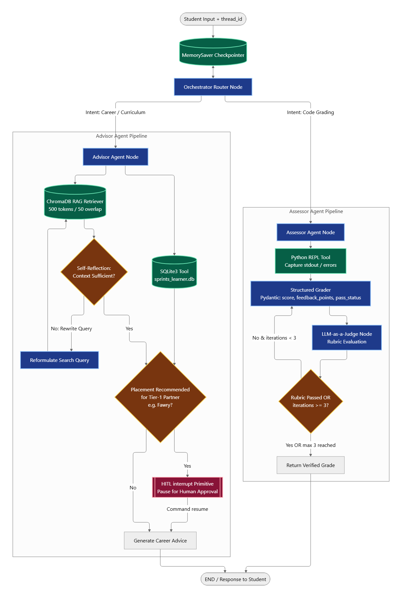

# Sprints Multi-Agent AI Career & Assessment Orchestrator



A stateful, multi-agent AI orchestration platform built for **Sprints ("Masar")** using **LangGraph**, **LangChain**, **ChromaDB**, **SQLite3**, **Pydantic**, and **Streamlit**.

The system unifies two core bootcamp workflows under a single intelligent supervisor:
1. **Career & Curriculum Advisory (`advisor_agent`):** Answers curriculum and track questions using self-reflective semantic retrieval (`sprints_curriculum.md`), queries verified student records (`sprints_learner.db`), enforces a Zero-Fallback Identity Gate, and escalates Tier-1 hiring partner referrals (**Fawry**, **InstaPay**, **Vodafone**) to a human Career Coach via LangGraph `interrupt()`.
2. **Automated Python Code Assessment (`assessor_agent`):** Extracts submitted Python code, executes it deterministically in a live captured REPL (`stdout`/`stderr`), generates structured Pydantic JSON grades, and audits every evaluation through an independent **LLM-as-a-Judge** loop.

---

## System Architecture

```text
                  ┌──────────────────────────────────────┐
                  │   Streamlit Studio UI (app.py)       │
                  │  • Masar Chat & Code Composer        │
                  │  • Live Execution Sequence Graph     │
                  │  • Career Coach HITL Approval Card   │
                  └──────────────────┬───────────────────┘
                                     │ thread_id (MemorySaver)
                                     ▼
                  ┌──────────────────────────────────────┐
                  │   Orchestrator Intent Router (US-01) │
                  └─────────┬──────────────────┬─────────┘
                            │                  │
                      (advisor)            (assessor)
                            │                  │
                            ▼                  ▼
       ┌────────────────────────────┐    ┌────────────────────────────────┐
       │      ADVISOR SUBGRAPH      │    │       ASSESSOR SUBGRAPH        │
       │                            │    │                                │
       │ 1. Zero-Fallback Identity  │    │ 1. Python Code Extraction      │
       │    Gate                    │    │ 2. Live Python REPL (US-05)    │
       │ 2. SQLite Learner DB       │    │    (exec + stdout capture)     │
       │    Lookup (US-03)          │    │ 3. Pydantic JSON Grader        │
       │ 3. ChromaDB RAG + Self-    │    │    (US-06)                     │
       │    Reflection Rewrite Loop │    │ 4. LLM-as-a-Judge Audit Loop   │
       │    (US-02, max 2 retries)  │    │    (US-07, up to 3 passes)     │
       │ 4. Tier-1 Partner HITL     │    └────────────────────────────────┘
       │    interrupt() Gate (US-04)│
       └────────────────────────────┘
```

---

## User Stories Implemented (`US-01` – `US-08`)

Every feature in this repository maps directly to eight end-to-end engineering user stories:

| ID | User Story | Implementation & Verification |
| :--- | :--- | :--- |
| **US-01** | **Intent Routing & Session Isolation** | `src/agents/orchestrator.py` classifies user intent and routes between `advisor_agent` and `assessor_agent`. `MemorySaver` isolates conversation history and graph state per `thread_id`. |
| **US-02** | **Self-Reflection ChromaDB Curriculum RAG** | `src/tools/rag_retriever.py` chunks `sprints_curriculum.md` (`500` chars, `50` overlap) and embeds locally with `all-MiniLM-L6-v2` in ChromaDB (`< 700 ms` latency). A Pydantic `DocumentGrade` node checks relevance and triggers up to 2 LLM query rewrites if needed. |
| **US-03** | **SQLite3 Learner Database Integration** | `src/tools/db_queries.py` queries `data/sprints_learner.db` to retrieve verified student metrics (`bootcamp_track`, `completed_modules`, `python_assignment_score`, `readiness_status`). |
| **US-04** | **Tier-1 Partner Human-in-the-Loop (HITL) Escalation** | When a learner requests placement approval for **Fawry**, **InstaPay**, or **Vodafone**, `advisor_agent.py` suspends execution via LangGraph's `interrupt()`, surfacing a Career Coach review card in Streamlit until resumed via `Command(resume=...)`. |
| **US-05** | **Live Python REPL Code Execution** | `src/tools/code_repl.py` runs extracted student code in an isolated namespace with `io.StringIO` `stdout` capture and structured runtime exception tracebacks. |
| **US-06** | **Structured Pydantic Grading Output** | `GradingResult` in `src/agents/assessor_agent.py` enforces valid JSON output containing `score` (`0–100`), `feedback_points` (`list[str]`), and `pass_status` (`bool`, `score >= 70`). |
| **US-07** | **Evaluator-Optimizer LLM Judge Loop** | An independent `JudgeVerdict` node audits every grade against actual REPL `stdout` and loops back for refinement (up to 3 iterations) if inconsistencies or runtime errors are detected. |
| **US-08** | **Shared State & Execution Observability** | `OrchestratorState` (`src/state.py`) shares context across subgraphs, emitting standardized execution traces and driving a dynamic Graphviz sequence diagram in the UI. |

---

## Key Architectural Highlights

* **Zero-Fallback Identity Gate:** General curriculum inquiries (e.g., *"What is the best track for an AI engineer?"*) query ChromaDB directly without touching SQLite or assuming a default student profile. Personal eligibility or placement requests without a Learner ID (`SPR-XXXX`) or full name prompt the user to identify themselves first.
* **No Hallucinated Authority:** Tier-1 hiring partner referrals pause deterministically at the state-machine level (`interrupt()`) and cannot proceed until a human Career Coach approves or places the request on hold.
* **Execution-Grounded Code Evaluation:** Code assessments are anchored to real Python `stdout`/traceback evidence rather than static LLM guessing.

---
## Data & Curriculum Knowledge Base Note

Note on data/sprints_curriculum.md: The official Sprints curriculum documentation was not provided in the project resources, so I authored a custom, structured curriculum knowledge base (`data/curricilum_docs/sprints_curriculum.md`) from scratch. It defines the bootcamp learning tracks, core module codes and prerequisites (`AI-101 through AI-104, BE-201, BE-202`), minimum assessment score thresholds (80%+), and Tier-1 hiring partner eligibility rules (`Fawry, InstaPay, Vodafone`) to ground the ChromaDB RAG pipeline and database cross-checks

## Project Structure

```text
Sprints-Multi-Agent-AI-Career-and-Assessment-Orchestrator/
├── .streamlit/
│   └── config.toml                     # Sprints brand UI theme (#0052CC royal blue & crisp white)
├── data/
│   ├── sprints_curriculum.md           # Official Sprints tracks, modules & partner rules
│   ├── sprints_learner.db              # SQLite3 student records database
│   └── chroma_db/                      # Persisted local ChromaDB vector store
├── notebooks/
│   └── evaluator_optimizer_loop.ipynb  # Standalone Evaluator-Optimizer verification notebook
├── src/
│   ├── state.py                        # Shared OrchestratorState TypedDict definition
│   ├── llm_provider.py                 # Configured LLM provider wrapper
│   ├── main.py                         # Master LangGraph compilation & CLI integration tests
│   ├── agents/
│   │   ├── orchestrator.py             # Supervisor intent router & conditional edge logic
│   │   ├── advisor_agent.py            # Identity gate, SQLite/RAG self-reflection & HITL subgraph
│   │   └── assessor_agent.py           # REPL execution, Pydantic grader & Judge loop subgraph
│   └── tools/
│       ├── rag_retriever.py            # ChromaDB semantic search tool
│       ├── db_queries.py               # SQLite3 learner database query tool
│       └── code_repl.py                # Captured Python execution REPL tool
├── app.py                              # Production Sprints Streamlit Studio UI
├── requirements.txt                    # Python dependencies
└── .env.example                        # Environment variable template
```

---

## Setup & Installation

### 1. Clone the Repository & Activate Environment
```bash
git clone <your-repository-url>
cd Sprints-Multi-Agent-AI-Career-and-Assessment-Orchestrator
conda activate langgraph_env
```

### 2. Install Dependencies
```bash
pip install -r requirements.txt
```

### 3. Configure Environment Variables
Create a `.env` file in the project root and add your LLM API key:
```env
GROQ_API_KEY=your_api_key_here
```
*(Ensure `.env` is listed in `.gitignore` so credentials are never committed.)*

---

## Running the Application

### Option A: Launch the Sprints Streamlit Studio UI (Recommended)
```bash
streamlit run app.py
```
Open `http://localhost:8501` in your browser to interact with:
* **Quick Demo Journeys:** Test general track discovery, Tier-1 Fawry HITL escalation (`SPR-1001`), and live Python code grading in one click.
* **Career Coach HITL Card:** Approve or place Tier-1 referrals on hold with custom coach notes when `interrupt()` triggers.
* **Retrieval & Execution Inspector:** View retrieved ChromaDB chunks, SQLite student rows, numeric assessment scores, and the live execution sequence diagram.

### Option B: Run the End-to-End CLI Integration Suite
```bash
python src/main.py
```
Executes automated verification across:
1. Self-reflection RAG query rewriting on unlisted module prerequisites.
2. Tier-1 **Fawry** placement escalation (`interrupt()` pause + `Command(resume=...)`).
3. Recursive Python factorial grading (`fact(5) == 120`) through the Evaluator-Optimizer Judge loop.

---

## Sample Test Prompts

* **General Track Advice (ChromaDB RAG only):**
  > *"Tell me the best track for me, I am an AI engineer and studied machine learning."*
* **Unauthenticated Placement Check (Identity Gate):**
  > *"Am I eligible to apply for a job at Fawry?"*
* **Tier-1 Partner Placement Escalation (SQLite + RAG + HITL Pause):**
  > *"Hi, I'm SPR-1001. Can you approve my placement application to Fawry?"*
* **Python Code Evaluation (REPL + Pydantic Grader + LLM Judge):**
  > *"Grade my Python factorial code:*
  > ```python
  > def fact(n):
  >     return 1 if n <= 1 else n * fact(n-1)
  > print(fact(5))
  > ```
  > *"*

 